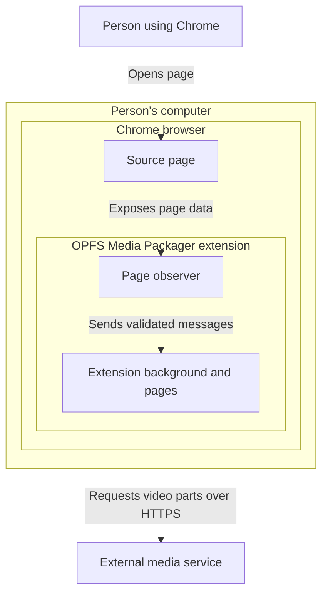
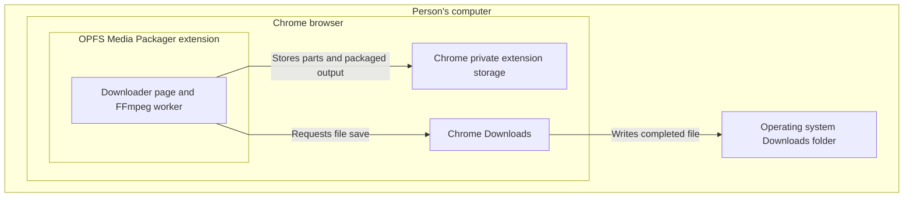

# Architecture

OPFS Media Packager keeps many reusable download rules in `lib/` and coordinates browser workflows in its entry files. Several rules run in Node.js tests. The separation is partial because some modules update page elements or perform network requests.

## Architectural styles and patterns

The extension is an event-driven Manifest V3 browser application. Chrome wakes the background service worker for browser events, page scripts observe signed-in pages, and extension pages render user actions and progress.

| Style or pattern                     | Meaning in this project                                                                                      | Code evidence                                                                                                                        | Why it matters                                                                              |
| ------------------------------------ | ------------------------------------------------------------------------------------------------------------ | ------------------------------------------------------------------------------------------------------------------------------------ | ------------------------------------------------------------------------------------------- |
| Functional core and imperative shell | Many calculations are separated from browser actions.                                                        | `lib/` includes pure rules and also contains network and page-element helpers. Browser entry files coordinate workflows.             | Pure rules can be tested without the browser.                                               |
| Layered architecture                 | Page observation, extension coordination, user interface, and reusable rules have separate responsibilities. | Page observers, background coordinator, user interface entry points, and reusable rules in `lib/`.                                   | A change to page detection has a limited path to download behaviour.                        |
| Ports and adapters influence         | Some browser and website details are handled by dedicated page scripts and helpers.                          | Chrome message handlers and page scripts adapt external values. Some `lib/` helpers also access browser-facing APIs.                 | The separation provides places to test selected boundaries.                                 |
| Adapter pattern                      | One selected adapter reads one track-page structure.                                                         | The page adapter selects a reader from the URL structure. The player adapter handles adjacent quality manifests. Both are in `lib/`. | Provider branding stays out of behaviour and a new page structure gets an isolated adapter. |
| Boundary validation                  | Page data is checked at selected message and request boundaries.                                             | Page observation, background coordination, and validation rules in `lib/`.                                                           | Checks reduce risk from untrusted page input. Review every new path.                        |
| Immutable value objects              | A value is created as a complete description and then treated as read-only.                                  | `readonly` types and `Object.freeze` for streams, plans, quality options, and checkpoints.                                           | Async tasks share stable data and avoid accidental cross-task mutation.                     |
| Single-writer queue                  | Concurrent scan workers submit updates through one serialized write chain per track scan.                    | The track scan update queue in the background coordinator.                                                                           | Parallel discovery cannot overwrite another worker's items or progress.                     |
| Finite-state model                   | A download item has a limited set of outcomes and the queue has explicit pause rules.                        | Item outcomes in the downloader and the track queue policy in `lib/`.                                                                | Cancellation, one-item failure, and session-wide failure have distinct behaviour.           |
| Checkpoint and idempotent retry      | Saved progress identifies completed work so retries can reuse it safely.                                     | OPFS checkpoints and stable stream keys in the downloader and `lib/`.                                                                | A paused download resumes without fetching completed segments again.                        |
| Resilience patterns                  | Controlled retries, backoff, adaptive concurrency, and a circuit breaker handle temporary host failures.     | Segment retry and concurrency rules, plus the track scanner rate limiter.                                                            | The extension avoids rapid repeated requests when a host is overloaded.                     |
| Defense in depth                     | Several independent checks protect the same boundary.                                                        | Sender checks, URL validation, folder validation, scoped request rules, CSP, and contract tests.                                     | A failed check at one layer does not grant unsafe browser access.                           |

These pattern names describe design influences and selected examples. They are not claims that the whole project enforces a formal architecture. In particular, `lib/` includes browser-facing and network code. `npm run check:architecture` checks direct browser-global access in selected reusable modules. It does not establish complete dependency isolation.

## Object Calisthenics profile

The [Object Calisthenics profile](object-calisthenics.md) explains the project rules, their intent, and which checks enforce them.

## Browser boundaries

The diagram shows the current extension and its main external services. Page data is untrusted until its URL, length, and shape are validated. Chrome manages the website session. A media URL can contain a temporary access token.

**System context: how the extension reaches external services**

**Local media: where the extension packages and saves a video**

Chrome private extension storage is managed by the browser on the person's disk. The operating system Downloads folder is the user-visible destination. The downloader can also use a memory-backed workspace if private storage is unavailable. The source page requests its content from the external host. The downloader writes video parts to private storage and reads the packaged output. Some hosts require requests through the signed-in page context, which this overview does not expand.

## Audit traceability

| Concern                       | Control                                                       | Evidence to review                                                                    |
| ----------------------------- | ------------------------------------------------------------- | ------------------------------------------------------------------------------------- |
| Page data trust               | Validate page messages before storage or downloads.           | Validation rules in `lib/` and message and security tests in `tests/`.                |
| Provider independence         | Select readers by stable page structure.                      | Page adapters in `lib/` and detection and anonymization tests in `tests/`.            |
| Concurrent scan safety        | Serialize state changes for each track scan.                  | The scan update queue in the background coordinator and track scan integration tests. |
| Access and rate-limit failure | Classify the failure and apply a central queue policy.        | Failure classification and track queue rules in `lib/`.                               |
| Resume correctness            | Verify saved parts before reusing them.                       | Checkpoint validation in `lib/` and large-file recovery tests in `tests/`.            |
| Browser build integrity       | Confirm each manifest and HTML entry references a built file. | Build checks in `scripts/` and packaging contract tests in `tests/`.                  |

## Track scan

The [track scan guide](track-scan.md) explains request pacing, fallback methods, and rate-limit handling.

## Download and resume

The [download and resume guide](download-and-resume.md) shows how the extension fetches video parts, packages the output, and handles interrupted work.

## Track queue

The download coordinator processes items in order. Each item returns `completed`, `cancelled`, or `failed`. A failure category tells the queue whether to continue or pause.

| Category       | Example                                    | Queue action                          |
| -------------- | ------------------------------------------ | ------------------------------------- |
| `item`         | One item has invalid media.                | Record it and continue.               |
| `unauthorized` | The host returns HTTP 401 or 403.          | Pause after two consecutive failures. |
| `rate-limited` | The host returns HTTP 429 or 503.          | Pause immediately.                    |
| `engine`       | The local download or FFmpeg engine fails. | Pause immediately.                    |

The track scanner has its own request pacing and retry policy while discovering items. The download coordinator handles download retries and queue pauses separately.

## Project map

The [project map](project-map.md) identifies the extension entry points and their responsibilities.

## Automated architecture checks

The architecture tests in [`tests/`](../tests/) use the TypeScript parser to inspect selected reusable rules for browser globals, including literal access through `globalThis`. The checks also reject imports from extension entry files in `lib/`, keeping library modules independent of page coordinators. The check examines source syntax. Aliases, computed names and indirect dependencies still need review.
