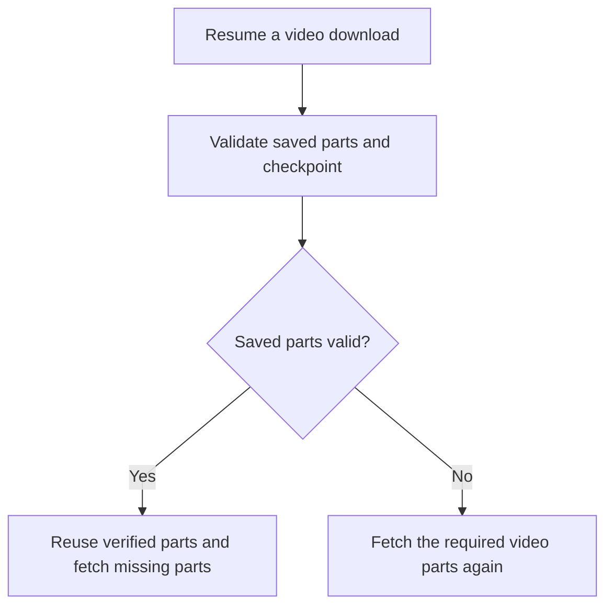

# Large downloads and checkpoints

**Scenario:** A download stops after saving part of a video. A checkpoint records saved parts so the extension can check them before reuse.

The normal disk-backed path uses OPFS, Chrome's private extension storage. Available disk space and browser storage access still limit the download. The memory-backed fallback does not provide the same disk checkpoint. See the [download and resume guide](../download-and-resume.md) for saving and failure paths.
