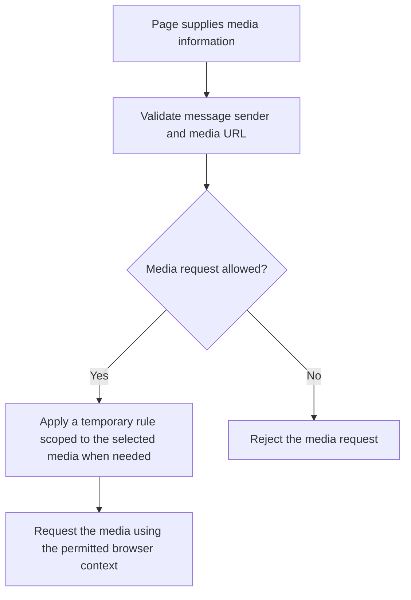

# Media access and credentials

**Scenario:** An untrusted page supplies a video URL. The extension must validate the URL before privileged network access. Some hosts also require the signed-in page's request context.

The extension does not export the browser's session credentials. A host can still reject a request or an access token can expire. The [security controls](../../SECURITY.md) describe the checks and their limits.
