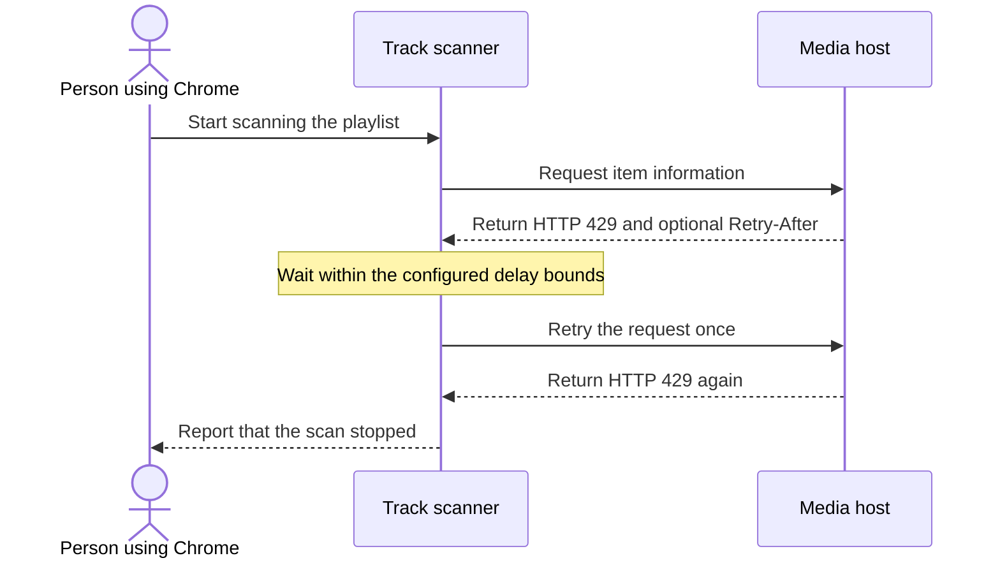

# Track scan pacing

**Scenario:** A media host responds with HTTP 429, meaning it is asking the extension to slow its requests. The following sequence shows the page-request retry path. A second consecutive rate-limit response stops the scan and keeps items already found.

The dashed return arrows show responses. The scanner spaces requests by at least 550 milliseconds and bounds the host-provided retry delay to 1.5 through 15 seconds. Other scan outcomes and fallback methods are shown in the [track scan flow](../track-scan.md).
