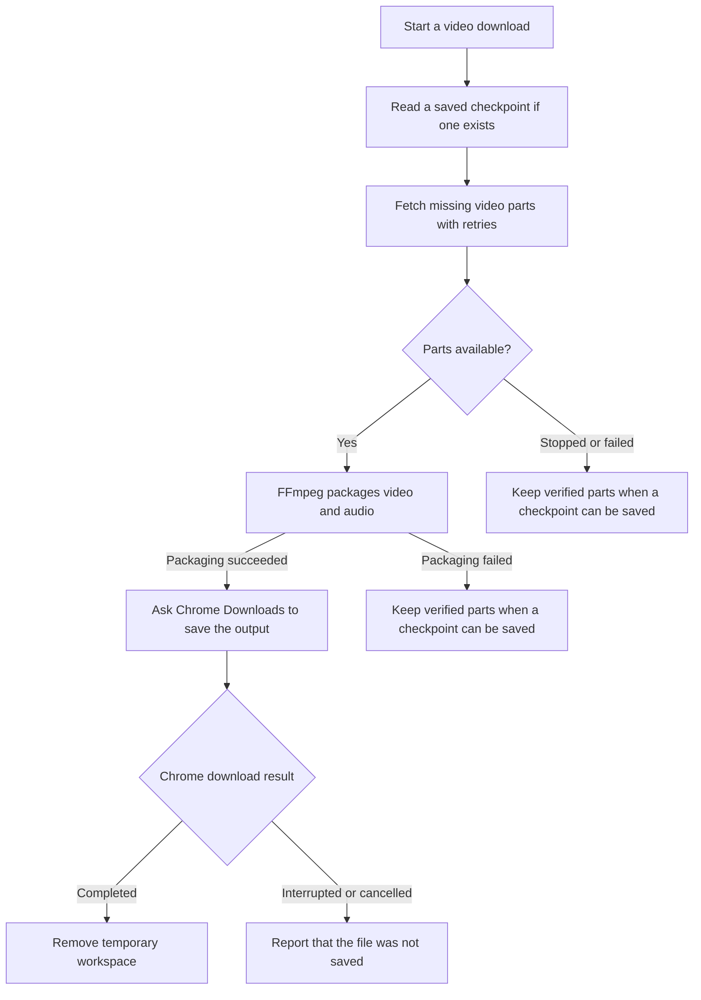
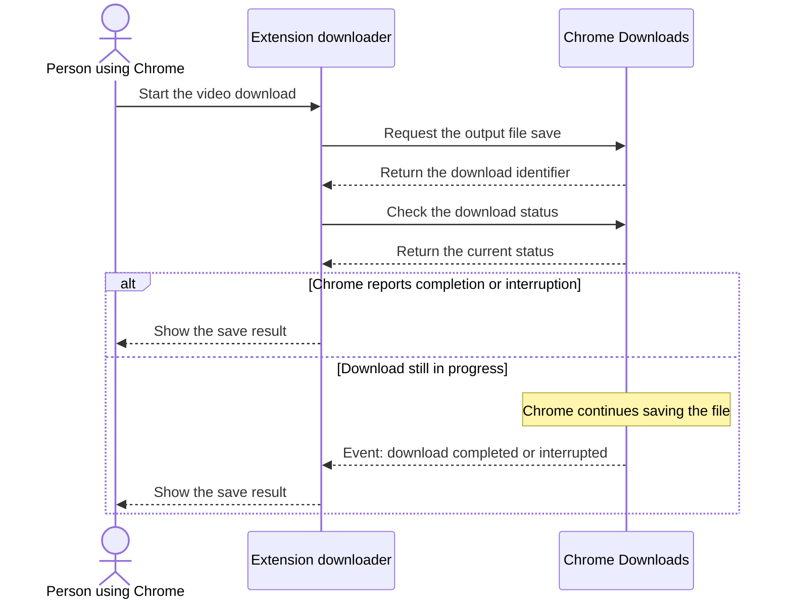

# Download and resume

An HLS manifest lists segments, which are small pieces of the video. The Downloader page fetches the selected quality, stores temporary pieces on disk, and asks FFmpeg to package them into the selected file format.

**Download: completed output and interrupted work**

**Save sequence: request acceptance and completed output**

This sequence shows the current save path. Chrome can report that a file has already completed when the extension checks its status. Otherwise, Chrome sends a later status event. Dashed event arrows are the visual convention used in this documentation. Unified Modeling Language (UML) normally uses a solid open arrow for an asynchronous signal.

For a playlist, the extension also checks Chrome's download history and can skip a file that still exists. If private storage is unavailable, the memory-backed fallback does not provide the same disk checkpoint. The diagram omits individual segment retries and subtitle handling.

OPFS is Chrome's private disk area for the extension. It reduces the need to hold downloaded parts in browser memory when available. If OPFS cannot be opened, the download uses a memory-backed fallback. A checkpoint records which parts have completed. The downloader attempts to save a checkpoint after each complete part and when a download stops, so it can reuse verified parts later.

Chrome's downloads history may report a deleted file as existing until an asynchronous filesystem check finishes. Chrome limits how frequently it checks. See [maintenance and troubleshooting](maintenance.md) before diagnosing a skipped file. The bundled browser test waits for Chrome to update its record before checking a retry.

FFmpeg performs a remux. A remux copies the existing video and audio into MP4 or MKV without changing their quality. An MP4 download can save a matching WebVTT subtitle file. An MKV download can store the selected subtitle inside the video file.

Related docs: [Architecture](architecture.md), [Maintenance and troubleshooting](maintenance.md), and [Testing and quality](testing-and-quality.md).
