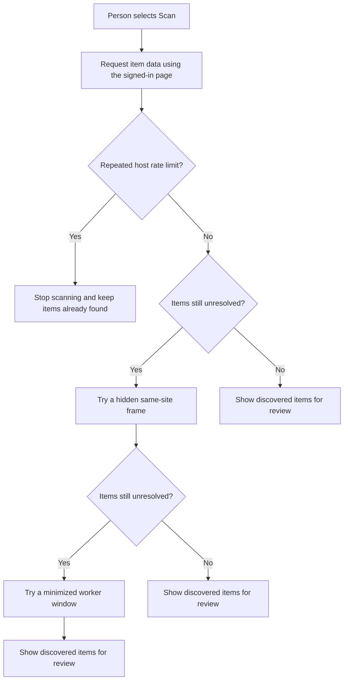

# Playlist scan

A playlist scan finds items, streams, subtitles, and companion documents. It starts with a signed-in page request. A hidden same-site frame is used when a page must render its data. A minimized worker window is available for the small group of pages that need a complete tab environment.

**Playlist scan: how unresolved items move through fallback methods**

The scan can discover some items at each stage. The minimized window is used only when the earlier methods leave items unresolved and a full tab environment is needed. The diagram summarizes the fallback order and does not show every error path.

The page request path reserves slots at least 550 milliseconds apart. It uses the server's `Retry-After` delay within a bounded range of 1.5 to 15 seconds. HTTP 429 means the host received too many requests. HTTP 503 means the host is temporarily unavailable. A second consecutive rate-limit response stops this scan and keeps items already found. Download requests use a separate retry policy.

Page adapters in `lib/` are selected from stable route and page structures. They do not depend on website names.
